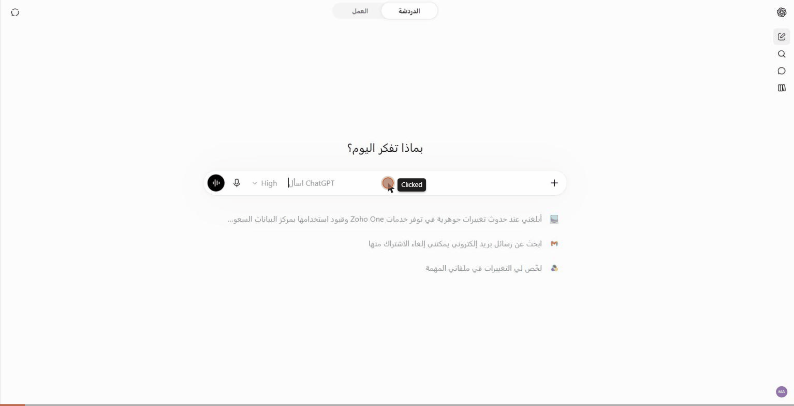

# Saudi Law Portal — MCP connector

Remote MCP server: `https://mcp.law.arbiter.sa/mcp` (Streamable HTTP, OAuth 2.1).

Saudi Law Portal ([law.arbiter.sa](https://law.arbiter.sa)) connects AI assistants to an organised library of Saudi statutes, implementing regulations and international agreements, built from official sources.

## Tools

| Tool | What it does |
|---|---|
| `search_provisions` | Finds relevant articles with a verbatim summary, a match-strength label, status (in force / amended / repealed) and a link. |
| `get_provision` | Returns the full text of articles, or a whole statute in pages. |
| `analyze_facts` | Applicable provisions, material facts and the competent court for redacted facts. |
| `rate_result` | Optional feedback on a result. |

Results are a research aid, not legal advice. Every result links back to law.arbiter.sa.

## Demo (ChatGPT)

## Links

- Developer documentation: https://law.arbiter.sa/developers
- Privacy policy: https://law.arbiter.sa/privacy#connectors-en
- Support: majed@arbiter.sa
